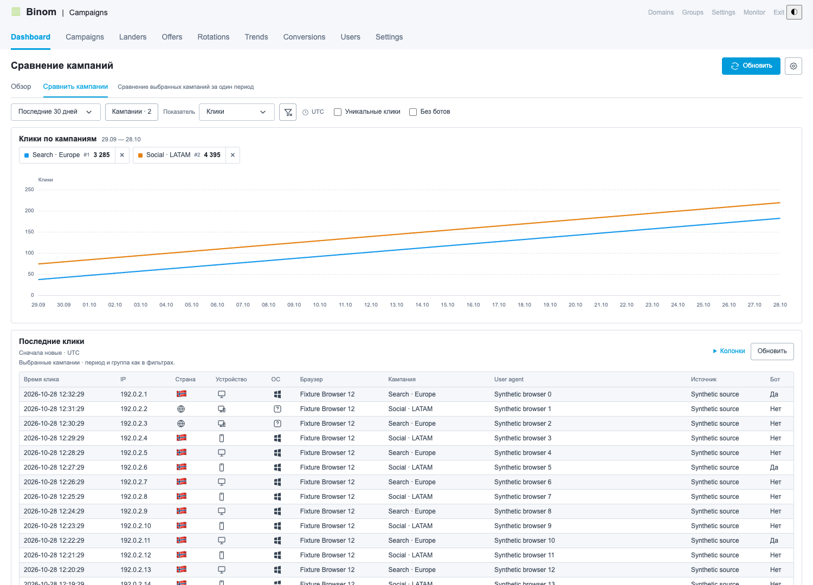

# Binom Dashboard

**English** · [Русский](#русский)



## English

A Chrome/Edge extension that adds **"Dashboard" to the Binom v2 top menu, before Campaigns**. The dashboard opens as a separate page inside the familiar admin panel layout. Version 0.6.13 is a preview release for testing on your own installation. Binom files on the server are not modified.

The extension menu offers **Language / Язык: English or Русский**. English is selected by default; the setting applies to the dashboard, the menu and the connection page. The language of Binom itself and campaign names stay unchanged.

### Installation

1. Download `binom-dashboard-0.6.13.zip` from the [Releases](https://github.com/CPARIP/Binom-Dashboard/releases) page and unzip it into a permanent folder.
2. Open `chrome://extensions` (in Edge, `edge://extensions`).
3. Turn on "Developer mode" → "Load unpacked".
4. Select the **binom-dashboard** folder that contains `manifest.json`.
5. Click the extension icon and choose **"Connection settings"**.
6. Paste the full URL of your Binom **Campaigns page**. HTTPS is required. The time zone is loaded from Binom when you connect.
7. Enter the API key of a separate Binom user with **Read** access to the campaigns and columns you need. Choose password-protected storage, set a separate password of at least 12 characters and repeat it. Click "Connect Binom" and allow access to this site.
8. Open or refresh the Binom tab and select **"Dashboard"** in the top menu, before **Campaigns**.

"Dashboard" is an extension page inside the admin panel: it uses a local route marker and reversibly switches the visible content. Going to Campaigns brings back the standard table. The extension does not create any pages or files on the Binom server.

After restarting the browser, or after disabling, reloading or updating the extension, open its settings and enter **only the unlock password**. You do not need to enter the API key again. No statistics requests are made until the key is unlocked. The extension does not save the password; choose a long, unique passphrase. If you forget the password, reconnect Binom with the original API key and a new password.

"Lock key" clears the decrypted key and the charts while keeping the encrypted copy and the settings. "Delete saved key" deletes both copies of the key while keeping the settings. "Forget connection" also deletes the settings and the site permission. The "Current browser session only" mode requires entering the API key again after a browser restart.

The temporary login parameter `auth` and the internal `binomDashboard` marker are removed from the campaigns URL before it is saved. Secret parameters such as `api-key`, `token` and `password` are not accepted in the saved URL.

The time zone is read from Binom when you connect and every time you unlock the key. If reading it is not allowed or the response is invalid, the connection is not completed; the previous settings and the encrypted key are kept.

To install from source, run the build first and select the `dist` folder.

### Extension menu

- **"Language"** — English or Русский; applies immediately to open tracker tabs. The same choice is available on the settings page.
- **The "Dashboard" switch** turns Dashboard off: it removes the menu item and its view, restores the standard workspace and stops new statistics requests. The connection, key and preferences are kept. Turning the switch back on restores the menu item.
- **"Connection settings"** opens the page for connecting and managing the key.

Turning the dashboard off with this switch is not the same as disabling the extension in Chrome: the key remains available until it is locked or the extension session ends.

### Updating

Replace the files inside the previously installed `binom-dashboard` folder with the files from the folder of the same name in the new archive, then click the reload button on the Binom Dashboard card at `chrome://extensions`. Open Binom tabs pick up the new version automatically; when updating from version 0.6.12 or earlier, refresh them manually once. You do not need to load a second copy of the extension. If the key is saved with a password, enter only the unlock password in the settings.

### Charts

In Overview mode:

- All available campaigns, a group or a single campaign. When a group is selected, the campaign field is disabled; for a single campaign, comparison with the previous period is available, and the group and source fields are disabled.
- Clicks, conversions, cost, revenue, profit and ROI by default; in the settings you can hide cards and add CR, EPC, CPC and the number of bots. Metrics that the Binom API does not provide are not offered.
- Clicking a card toggles its line. Counts and percentages use the left scale; money uses the right one.
- Today, yesterday, the last 7/14/30 days and a custom range of up to 366 days. The time step is chosen automatically: hourly for a single day, daily for several days.
- Group, source and the **"Exclude bots"** checkbox: traffic that Binom itself has marked as bots is excluded. Days or hours without clicks remain on the chart as empty points; totals are calculated from the data received.
- The **"Unique clicks"** checkbox switches the click count, the chart and the traffic composition to Binom unique clicks (tracker-wide uniqueness). Other metrics do not change; if the field is not available to the API user, "—" is shown.
- The previous period as a dashed line, and changes on the cards; the current incomplete day is compared with the same time in the previous period.
- Normal scrolling over the chart scrolls the page; Ctrl + mouse wheel zooms the chart. Optional auto refresh is available every minute or every five minutes.

In **"Compare campaigns"** mode, select up to **8 campaigns**: one chart shows a separate line for each campaign, and the period and metric are shared. An error for one campaign is shown separately; the other lines remain. Group and source filters and comparison with the previous period do not apply in this mode.

Campaign lists initially show collapsed groups with a campaign count. Expand a group or find a campaign by name, ID or group name; the search covers the whole catalog (up to 10,000 rows).

The **"Reset filters"** button after the source field keeps the current tab and returns to the last 30 days and all campaigns, groups and sources, with comparison, "Exclude bots" and unique clicks turned off. The time zone, card selection, click log columns and auto refresh are kept. The period and filters are kept across Dashboard → Campaigns → Dashboard navigation.

**Dashboard filters control only the dashboard's own data.** Selecting rows in the standard Binom table does not change the campaign selection.

Only one tracker can be connected per browser profile. Money metrics are shown in USD without currency conversion. Metric availability depends on the API user's permissions and Binom columns. Missing values are shown as "—". CR/EPC/CPC/ROI are calculated from totals only when the required columns are available; percentages are not averaged, and hidden metrics are not reconstructed.

### Traffic composition and recent clicks

Below the chart is the **traffic composition** with the "Campaigns", "Groups", "Sources" and "Countries" tabs. The "Campaigns" tab shows the ten largest campaigns by clicks and a gray "Others" segment; the other dimensions show the eight largest values and the remainder. Entries that exist only in the previous period are labeled separately. The tab for the selected campaign, group or source is hidden, and its report is not requested. Traffic composition is not shown when comparing campaigns.

**Recent clicks** are listed from newest to oldest; you can choose the columns and show **25, 50 or 100 rows** per page. By default, the columns are click time, IP, country, device, OS, campaign, traffic source, bot and click ID; browser, User-Agent, language and campaign ID can be added. Country, device and OS are shown as local icons, with the full name on hover. The click log follows the selected dates, campaigns and group. With the **"Exclude bots"** checkbox on, clicks that Binom has marked as bots are not shown, so a page may have fewer rows than selected; the source filter does not apply to the click log.

If the click log still shows "—" or reports that it cannot apply "Exclude bots", sign in to Binom **as the user who owns the API key**, open **Clicklog → Table settings**, enable the required columns (including "Bot") and refresh the dashboard.

Only the column selection and the click log page size are saved; IP, User-Agent and the records themselves stay in memory and are cleared when Dashboard is turned off or the connection is locked.

### Appearance

Dashboard is styled like Binom: colors, typography, buttons, fields and tables look the same as in the tracker. The extension does not change the look of the tracker's standard sections. The light and dark palettes are switched with Binom's built-in toggle in the header; if the theme signal is unavailable, the system color scheme is used. The settings page and the menu opened from the extension icon follow the browser's system color scheme.

### Security and privacy

- All executable code and the charting library are included in the package; no scripts or fonts are loaded from a CDN.
- There is no developer server, no analytics and no cloud sync of keys or statistics.
- The key is entered only on the extension's settings page and is used in the background worker. The plaintext key is stored only in `chrome.storage.session`, and the encrypted copy in `chrome.storage.local`; access to both is restricted to `TRUSTED_CONTEXTS`.
- Encryption is AES-GCM-256; the encryption key is derived from the password with PBKDF2-SHA256 (600,000 iterations), with a new random salt and IV on every save. The ciphertext is bound to the exact tracker address.
- The Binom page and the content script receive the displayed reports and click records, but not the key.
- The network client allows only the seven GET endpoints listed below. Arbitrary API paths, methods and headers from page messages are not accepted.
- Requests go directly to the configured HTTPS address with the `Api-Key` header, without cookies, caching, referer or following redirects.
- Permission is requested only for the specified site. `https://*/*` in **optional_host_permissions** is the list of domains that can be connected, not access to all sites.
- "Forget connection" deletes the key and settings and removes access to the site. To revoke the key itself, block it in the Binom users section.

| Allowed API endpoint | Purpose |
| --- | --- |
| `/public/api/v1/trends` | Overall time series |
| `/public/api/v1/groups/campaigns` | Campaign groups |
| `/public/api/v1/traffic_source/list/filtered` | Traffic sources |
| `/public/api/v1/campaign/list/filtered` | Campaigns available for reading |
| `/public/api/v1/report/campaign` | Time series for selected campaigns and traffic composition |
| `/public/api/v1/clicklog` | Recent clicks |
| `/public/api/v1/settings/info` | Time zone on connection and unlock |

Stored locally: the tracker URL, time zone, dashboard mode, selected campaigns, metrics and cards, overview period and filters, language, whether Dashboard is enabled, auto refresh, and the click log columns and page size. Reports, catalogs and click rows with IP/User-Agent are not written to persistent storage.

Encryption protects the saved copy of the key if your profile files fall into the hands of someone who does not know the password; its strength depends on the password. It does not protect against an infected device or a malicious extension update. Use a separate Binom user with Read permissions: the extension's list of requests does not limit the permissions of the key itself. See [PRIVACY.md](PRIVACY.md) for details.

### Limitations and troubleshooting

The adapter is based on the Binom v2 OpenAPI and checked against the official Binom interface. Responses and markup on a particular installation may differ; after a Binom update, the menu integration or styling may need adjustments. If the API repeats incomplete pages or sends an unknown data format, the extension shows an error instead of guessed totals.

If the "Dashboard" item does not appear, check in the extension menu that the dashboard is enabled, check the campaigns URL and the site permission, and refresh the tab. If an API error occurs, check the key, permissions, time zone and enabled columns. For troubleshooting, the error text and a screenshot **without the key** are enough; do not send HAR files or request headers.

### Building from source

Requires Node.js 22 or later; dependency versions are pinned in `package-lock.json`.

```sh
npm ci
npm run docs:check
npm run build
npm test
npx playwright install chromium
npm run test:browser
npm run test:insights
npm run test:extension
```

`dist` is the ready-to-use extension; after the build, `demo/index.html` shows a mockup with fictional data. `npm run package` creates the new version's archives in `release` and does not overwrite already released archives of the same version. Browser tests use a temporary Chromium profile, a local test certificate (`openssl` is required) and a fictional key.

Before pushing changes to the repository, enable commit checks: `git config --local core.hooksPath .githooks`.

The change history is in [CHANGELOG.md](CHANGELOG.md). The source code is licensed under MIT; library licenses are in `THIRD_PARTY_NOTICES.txt`. This project is not an official Binom product.

---

## Русский

Расширение для Chrome/Edge, которое добавляет **«Dashboard» в верхнее меню Binom v2 перед Campaigns**. Дашборд открывается отдельной страницей внутри привычной оболочки админки. Версия 0.6.13 — предварительная, для проверки на своей установке. Файлы Binom на сервере не изменяются.

В меню расширения доступен **Language / Язык: English или Русский**. По умолчанию выбран English; настройка применяется к дашборду, меню и странице подключения. Язык самого Binom и названия кампаний не меняются.

### Установка

Интерфейс расширения по умолчанию на английском: русский включается в меню расширения (**Language → Русский**). Ниже в скобках — названия на английском.

1. Скачайте `binom-dashboard-0.6.13.zip` со страницы [Releases](https://github.com/CPARIP/Binom-Dashboard/releases) и распакуйте в постоянную папку.
2. Откройте `chrome://extensions` (в Edge — `edge://extensions`).
3. Включите «Режим разработчика» → «Загрузить распакованное расширение».
4. Выберите папку **binom-dashboard**, внутри которой лежит `manifest.json`.
5. Нажмите значок расширения и выберите **«Настройки подключения»** (Connection settings).
6. Вставьте полный адрес **страницы Campaigns** своего Binom. Нужен HTTPS. Часовой пояс загрузится из Binom при подключении.
7. Введите API-ключ отдельного пользователя Binom с правами **Read** на нужные кампании и колонки. Выберите сохранение с паролем, задайте отдельный пароль от 12 символов и повторите его. Нажмите «Подключить Binom» (Connect Binom) и разрешите доступ к этому сайту.
8. Откройте или обновите вкладку Binom и выберите в верхнем меню **«Dashboard»** перед **Campaigns**.

«Dashboard» — страница расширения внутри админки: она использует локальный маркер маршрута и обратимо переключает видимое содержимое. Переход в Campaigns возвращает штатную таблицу. Расширение не создаёт страниц или файлов на сервере Binom.

После перезапуска браузера, отключения, перезагрузки или обновления расширения откройте его настройки и введите **только пароль разблокировки**. Повторно вводить API-ключ не нужно. До разблокировки запросы статистики не выполняются. Пароль расширение не сохраняет; выберите длинную уникальную фразу. Если пароль забыт, подключите Binom заново с исходным API-ключом и новым паролем.

«Заблокировать» очищает открытый ключ и графики, сохраняя зашифрованную копию и настройки. «Удалить сохранённый ключ» удаляет обе копии ключа, сохраняя настройки. «Забыть подключение» также удаляет настройки и разрешение на сайт. Режим «только на сеанс» требует повторного ввода API-ключа после перезапуска браузера.

Временный параметр входа `auth` и служебный маркер `binomDashboard` удаляются из адреса кампаний перед сохранением. Секретные параметры вроде `api-key`, `token` и `password` в сохраняемом адресе не принимаются.

Часовой пояс читается из Binom при подключении и каждой разблокировке ключа. Если чтение запрещено или ответ некорректен, подключение не завершается; прежние настройки и зашифрованный ключ сохраняются.

Для установки из исходников сначала выполните сборку и выберите папку `dist`.

### Меню расширения

- **«Язык»** — English или Русский; применяется сразу к открытым вкладкам трекера. Тот же выбор есть на странице настроек.
- **Переключатель «Дашборд»** выключает Dashboard: убирает пункт меню и его представление, возвращает штатную рабочую область и прекращает новые запросы статистики. Подключение, ключ и предпочтения сохраняются. Включённый переключатель возвращает пункт меню.
- **«Настройки подключения»** открывают страницу подключения и управления ключом.

Выключение дашборда этим переключателем не равно отключению расширения в Chrome: ключ остаётся доступен до его блокировки или завершения сеанса расширения.

### Обновление

Замените файлы внутри ранее установленной папки `binom-dashboard` файлами из одноимённой папки нового архива и нажмите кнопку перезагрузки карточки Binom Dashboard на `chrome://extensions`. Открытые вкладки Binom получают новую копию автоматически; при обновлении с версии 0.6.12 или более ранней обновите их один раз вручную. Вторую копию расширения загружать не нужно. Если ключ сохранён с паролем, введите в настройках только пароль разблокировки.

### Графики

В режиме общего обзора:

- Все доступные кампании, группа либо одна кампания. При выбранной группе поле кампании отключено; для одной кампании работает сравнение с предыдущим периодом, а поля группы и источника отключены.
- Клики, конверсии, расход, доход, прибыль и ROI по умолчанию; в настройках можно скрыть карточки и добавить CR, EPC, CPC и число ботов. Метрики, не предусмотренные API Binom, не предлагаются.
- Нажатие карточки переключает её линию. Количество и проценты используют левую шкалу, деньги — правую.
- Сегодня, вчера, последние 7/14/30 дней и свой диапазон до 366 дней. Шаг выбирается автоматически: часы за один день, дни за несколько.
- Группа, источник и флажок **«Без ботов»**: исключается трафик, который Binom сам отметил ботами. Дни или часы без кликов остаются на графике пустыми точками, итоги считаются по полученным данным.
- Флажок **«Уникальные клики»** переключает количество кликов, график и состав на уникальные клики Binom (уникальность по трекеру). Остальные показатели не меняются; если поле недоступно API-пользователю, показывается «—».
- Предыдущий период пунктиром и изменения в карточках; текущий неполный день сравнивается с тем же временем прошлого периода.
- Обычная прокрутка над графиком прокручивает страницу, Ctrl + колёсико приближает график. Есть необязательное автообновление раз в минуту или пять минут.

В режиме **«Сравнить кампании»** выберите до **8 кампаний**: один график показывает отдельную линию каждой кампании, период и метрика общие. Ошибка одной кампании показывается отдельно, остальные линии сохраняются. Фильтры группы и источника и сравнение с предыдущим периодом в этом режиме не применяются.

В списках кампаний сначала видны свёрнутые группы со счётчиком кампаний. Раскройте группу или найдите кампанию по названию, ID либо названию группы; поиск охватывает весь каталог (до 10 000 строк).

Кнопка **«Сбросить фильтры»** после поля источника сохраняет текущую вкладку и возвращает последние 30 дней, все кампании, группы и источники, без сравнения, «Без ботов» и уникальных кликов. Часовой пояс, выбор карточек, колонки журнала и автообновление сохраняются. Период и фильтры сохраняются между переходами Dashboard → Campaigns → Dashboard.

**Фильтры дашборда управляют только его данными.** Выделение строк штатной таблицы Binom не меняет выбор кампаний.

Подключается один трекер на профиль браузера. Денежные показатели отображаются в USD без конвертации. Доступность метрик зависит от прав API-пользователя и колонок Binom. Отсутствующие значения показываются как «—». CR/EPC/CPC/ROI считаются из итоговых сумм только при доступности нужных колонок; проценты не усредняются, скрытые метрики не восстанавливаются.

### Состав трафика и последние клики

Под графиком — **состав трафика** с вкладками «Кампании», «Группы», «Источники», «Страны». Во вкладке «Кампании» видны десять крупнейших кампаний по кликам и серый сектор «Остальные»; в других разрезах — восемь крупнейших значений и остаток. Записи, которые есть только в предыдущем периоде, подписаны отдельно. Вкладка выбранной кампании, группы или источника скрывается, её отчёт не запрашивается. В сравнении кампаний состав не показывается.

**Последние клики** идут от новых к старым; можно выбрать колонки и показывать по **25, 50 или 100 строк**. По умолчанию видны время, IP, страна, устройство, ОС, кампания, источник, бот и ID клика; дополнительно — браузер, User-Agent, язык и ID кампании. Страна, устройство и ОС показываются локальными значками с полной подписью при наведении. Журнал следует выбранным датам, кампаниям и группе. С флажком **«Без ботов»** клики, которые Binom отметил ботами, не показываются, поэтому на странице может быть меньше строк, чем выбрано; фильтр источника к журналу не применяется.

Если в журнале остаются «—» или он сообщает, что не может применить «Без ботов», войдите в Binom **под пользователем, которому принадлежит API-ключ**, откройте **Clicklog → Table settings**, включите нужные колонки (в том числе «Бот») и обновите дашборд.

Сохраняются только выбор колонок и размер страницы журнала; IP, User-Agent и сами записи остаются в памяти и очищаются при выключении Dashboard или блокировке подключения.

### Оформление

Dashboard оформлен в стиле Binom: цвета, типографика, кнопки, поля и таблицы как в трекере. Оформление штатных разделов трекера расширение не меняет. Светлая и тёмная палитры переключаются штатным переключателем в шапке Binom; если сигнал темы недоступен, используется системная схема. Страница настроек и меню по значку следуют системной схеме браузера.

### Безопасность и приватность

- Весь исполняемый код и библиотека графиков входят в пакет; скрипты и шрифты с CDN не загружаются.
- Нет сервера разработчика, аналитики и облачной синхронизации ключей или статистики.
- Ключ вводится только на странице настроек расширения и используется в фоновом worker. Открытый ключ хранится только в `chrome.storage.session`, зашифрованная копия — в `chrome.storage.local`; доступ к обоим ограничен `TRUSTED_CONTEXTS`.
- Шифрование AES-GCM-256; ключ шифрования выводится из пароля через PBKDF2-SHA256 (600 000 итераций), новая случайная соль и IV при каждом сохранении. Шифротекст привязан к точному адресу трекера.
- Страница Binom и content script получают показанные отчёты и записи кликов, но не ключ.
- Сетевой клиент допускает только семь перечисленных ниже GET-адресов. Произвольные API-пути, методы и заголовки из сообщений страницы не принимаются.
- Запросы идут напрямую на настроенный HTTPS-адрес с заголовком `Api-Key`, без cookies, кеширования, referer и переходов по redirect.
- Разрешение запрашивается только для указанного сайта. `https://*/*` в **optional_host_permissions** — перечень доменов, которые можно подключить, а не доступ ко всем сайтам.
- «Забыть подключение» удаляет ключ и настройки и снимает доступ к сайту. Чтобы отозвать сам ключ, заблокируйте его в разделе пользователей Binom.

| Разрешённый API-адрес | Назначение |
| --- | --- |
| `/public/api/v1/trends` | Общий временной ряд |
| `/public/api/v1/groups/campaigns` | Группы кампаний |
| `/public/api/v1/traffic_source/list/filtered` | Источники трафика |
| `/public/api/v1/campaign/list/filtered` | Доступные для чтения кампании |
| `/public/api/v1/report/campaign` | Временной ряд выбранных кампаний и состав трафика |
| `/public/api/v1/clicklog` | Последние клики |
| `/public/api/v1/settings/info` | Часовой пояс при подключении и разблокировке |

Локально сохраняются адрес, часовой пояс, режим дашборда, выбранные кампании, метрики и карточки, период и фильтры обзора, язык, включение Dashboard, автообновление, колонки и размер страницы журнала. Отчёты, каталоги и строки кликов с IP/User-Agent в постоянное хранилище не записываются.

Шифрование защищает сохранённую копию ключа, если файлы профиля попадут к кому-то без пароля; стойкость зависит от пароля. Оно не защищает от заражённого устройства или злонамеренного обновления расширения. Используйте отдельного пользователя Binom с правами Read: перечень запросов расширения не ограничивает полномочия самого ключа. Подробнее — в [PRIVACY.md](PRIVACY.md).

### Ограничения и диагностика

Адаптер основан на OpenAPI Binom v2 и сверен с официальным интерфейсом Binom. Ответы и разметка конкретной установки могут отличаться; после обновления Binom интеграция меню или оформление могут потребовать доработки. Если API повторяет неполные страницы или присылает неизвестный формат данных, расширение показывает ошибку вместо предположительных итогов.

Если пункт «Dashboard» не появился, проверьте в меню расширения, что дашборд включён, проверьте адрес кампаний и разрешение на сайт и обновите вкладку. При ошибке API проверьте ключ, права, часовой пояс и включённые колонки. Для диагностики достаточно текста ошибки и скриншота **без ключа**; не отправляйте HAR или заголовки запросов.

### Сборка из исходников

Требуется Node.js 22 или новее; версии зависимостей закреплены в `package-lock.json`.

```sh
npm ci
npm run docs:check
npm run build
npm test
npx playwright install chromium
npm run test:browser
npm run test:insights
npm run test:extension
```

`dist` — готовое расширение, `demo/index.html` после сборки показывает макет на вымышленных данных. `npm run package` создаёт архивы новой версии в `release` и не перезаписывает уже выпущенные архивы той же версии. Браузерные проверки используют временный профиль Chromium, локальный тестовый сертификат (нужен `openssl`) и вымышленный ключ.

Перед отправкой изменений в репозиторий включите проверку коммитов: `git config --local core.hooksPath .githooks`.

История изменений — в [CHANGELOG.md](CHANGELOG.md). Лицензия исходного кода — MIT; лицензии библиотек — в `THIRD_PARTY_NOTICES.txt`. Проект не является официальным продуктом Binom.
